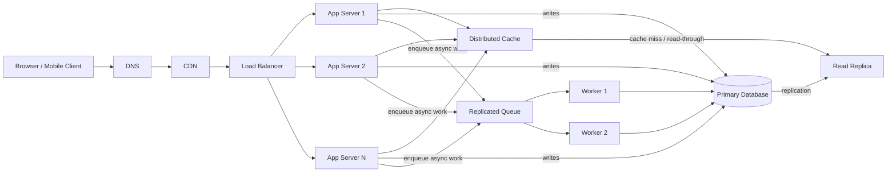

# QuickNotes Architecture

## Requirements

### Functional requirements

- Users can create notes with a required title (up to 100 characters) and body.
- Users can list their own notes with pagination, retrieve a note, update it, and delete it.
- Every note is associated with its owner; users cannot read or modify another user's notes.
- The API returns JSON and reports validation, authentication, authorization, missing-resource, and server errors with consistent error bodies.
- Note creation and updates are durable, and successful writes return the saved note.

### Non-functional requirements

- **Availability:** Keep note reads and writes available through individual instance or availability-zone failures.
- **Durability:** Acknowledge a write only after it has been committed to the primary database; replicate data and take recoverable backups.
- **Performance:** Target p95 latency below 300 ms for reads and below 500 ms for writes under the expected load, excluding client network time.
- **Scalability:** Scale stateless app servers horizontally and use caching, read replicas, and asynchronous workers to handle growth.
- **Security:** Require TLS, authenticate API requests, authorize every note by owner, validate inputs, and protect credentials and stored data.
- **Consistency:** Use the primary for writes and support read-after-write behavior; replica reads may be eventually consistent.
- **Observability:** Collect centralized logs, metrics, and traces, and alert on elevated errors, latency, queue depth, and database health.

## Load estimate for 1 million users

These are planning estimates, not measured production traffic. Assume 1 million active users, each making 10 list/read requests and creating 1 note per day. Use a 5x peak-over-average factor to account for traffic bursts.

| Measure | Estimate |
|---|---:|
| Reads | 10 million/day = about 116 reads/second average; plan for about **580 reads/second peak**. |
| Writes | 1 million/day = about 12 writes/second average; plan for about **60 writes/second peak**. |
| New storage | At 2 KB per stored note, including metadata and index allowance: 2 GB/day, or about **730 GB/year** of logical primary storage. |

The storage figure excludes replicas, backups, logs, and growth from edits. Replicas and backups require additional physical capacity; actual usage should be measured and the estimate revisited as note sizes and user behavior become known.

## High-level architecture

The CDN caches static application assets; authenticated note API responses are not shared-cached there. Cache note data by user and invalidate or refresh affected keys after a successful write.

### Components and the problems they solve

| Component | Problem it solves |
|---|---|
| Client | Provides the user interface for viewing and managing notes and sends API requests. |
| DNS | Resolves the API hostname to the service entry point so clients do not need a fixed server address. |
| CDN | Serves static assets close to users, reducing origin load and asset latency. |
| Load balancer | Distributes incoming API traffic across healthy app servers and removes unhealthy instances from rotation. |
| App servers (at least two) | Run stateless API logic, authentication, validation, and authorization while scaling horizontally. |
| Distributed cache | Avoids repeated database reads for frequently accessed note lists and note records. |
| Primary database | Provides the authoritative durable store and serializes note writes. |
| Read replica | Offloads read traffic from the primary and provides a copy for database failover. |
| Replicated queue | Buffers non-critical asynchronous tasks so request handling does not wait for them and temporary worker outages do not lose jobs. |
| Worker pool | Processes queued background work independently and can scale based on queue depth. |

## Request flows

### `GET /api/v1/notes`

1. The client resolves the API hostname through DNS and connects over TLS; static application assets may be served by the CDN.
2. The load balancer routes the API request to a healthy app server.
3. The app server validates the access token, derives the user identity, and validates pagination parameters.
4. The app server checks the distributed cache for the authenticated user's requested page of notes.
5. On a cache hit, the app server returns the cached page; on a miss, it queries the read replica using the user ID and pagination cursor.
6. The app server caches the result for a short TTL and returns `200 OK` with `items` and `nextCursor`.
7. When read-after-write consistency is needed (for example, immediately after creating a note), the app server reads from the primary or from a cache entry updated by the write rather than relying on a potentially lagging replica.

### `POST /api/v1/notes`

1. The client sends a JSON body and bearer token over TLS; DNS and the load balancer route the request to a healthy app server.
2. The app server authenticates the user, validates the title and body, and derives `ownerId` from the authenticated identity rather than trusting a client-supplied owner.
3. The app server creates a note ID and inserts the note into the primary database in a transaction.
4. After the database confirms the commit, the app server invalidates or refreshes the user's affected note-list cache and any relevant note cache.
5. If post-save work is required, the app server publishes a job to the replicated queue; the API does not wait for a worker to complete it.
6. The app server returns `201 Created` with the persisted note. If the database commit fails, it returns an error and does not report successful creation.
7. A worker consumes queued jobs, performs the background task, and retries transient failures according to a bounded retry policy.

## Trade-offs and failure handling

| Trade-off | Benefit and cost | How single points of failure are avoided |
|---|---|---|
| Cache reads versus fresh database reads | Caching reduces latency and database load, but introduces invalidation complexity and possible staleness. Use bounded TTLs, invalidate after committed writes, and route read-after-write requests to the primary or refreshed cache. | Run the cache as a multi-node/replicated cluster across availability zones; on cache failure, bypass it and read from the database with rate limiting. |
| Read replica versus primary-only reads | A replica increases read capacity and can help recovery, but replication lag means ordinary reads may briefly be stale. Keep writes on the primary and route consistency-sensitive reads accordingly. | Place the primary and replica in separate failure zones, monitor replication lag, and configure automated promotion of a healthy replica with tested backups and recovery procedures. |
| Asynchronous queue versus synchronous side effects | A queue shortens API latency and isolates background work, but completion is delayed and jobs need idempotent retry handling. The API reports note success only after the database commit, not after background work. | Use a replicated durable queue and multiple workers across zones; monitor queue depth and retry/dead-letter failed jobs rather than relying on one worker. |
| CDN delivery versus serving all assets from the application | A CDN improves static asset delivery and reduces origin bandwidth, but adds cache configuration and invalidation concerns. Dynamic authenticated note data remains on the API path. | Use a globally distributed CDN with multiple origins and health-based origin failover; keep the API origin independently redundant. |

No single app server, worker, cache node, or network entry instance should be required for service. Use multi-zone deployments for DNS/service endpoints, CDN origins, load balancers, app servers, cache, database, and queue; automate health checks and failover, and regularly test recovery procedures.
